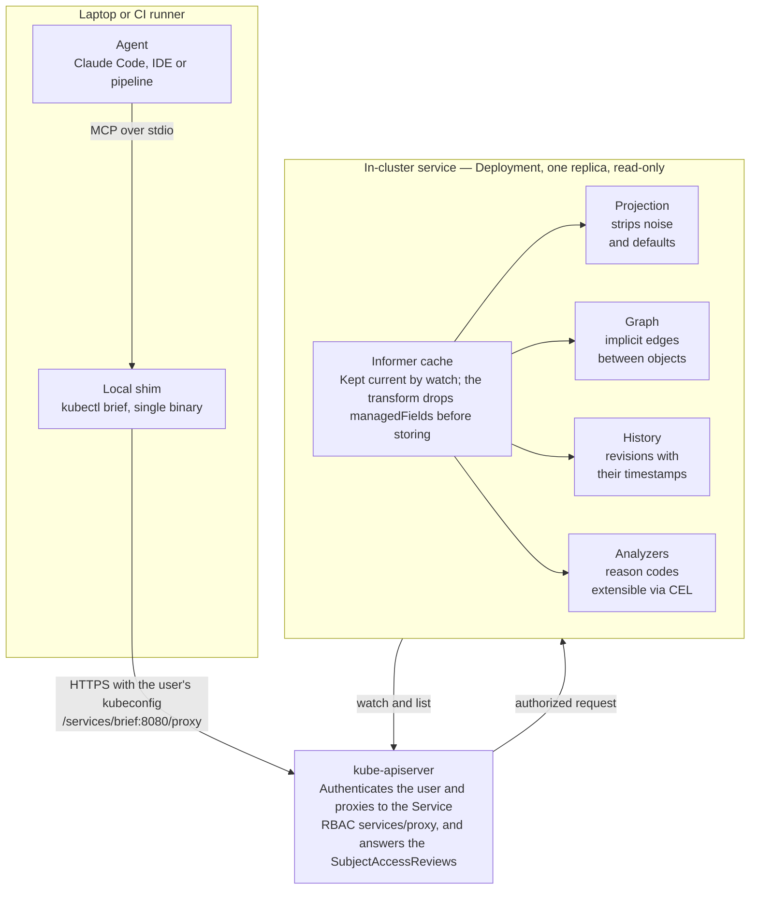
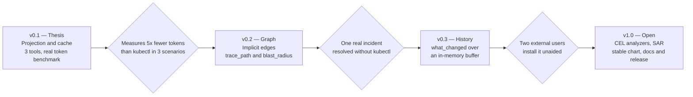

# brief

**A read-only MCP server that turns Kubernetes cluster state into answers an agent can afford to read.**

`brief` answers a full diagnostic question in one call instead of twelve, inside a context budget. It is not a `kubectl` wrapper: it projects, correlates, pre-computes and remembers.

> **Status: design stage.** This README is the design document. No code yet. Everything below is a plan open to argument — issues and PRs on the design itself are welcome.

---

## Table of contents

- [The problem](#the-problem)
- [Design principles](#design-principles)
- [Architecture](#architecture)
- [Components](#components)
- [Identity, RBAC and security](#identity-rbac-and-security)
- [MCP surface](#mcp-surface)
- [Extensibility](#extensibility)
- [Deployment and distribution](#deployment-and-distribution)
- [Technical decisions](#technical-decisions)
- [Roadmap](#roadmap)
- [Risks and open questions](#risks-and-open-questions)
- [Glossary](#glossary)
- [License](#license)

---

## The problem

The Kubernetes API is designed for controllers, not for readers on a context budget. A controller wants the whole object, typed, with every default resolved, and reads it a thousand times a second from a local cache. An agent wants the answer to a question, once, in as few tokens as possible. These are opposite requirements, and today the agent pays the difference.

### Structural noise

In a `kubectl get pod -o yaml`, most of the payload has no diagnostic value: `managedFields` (which alone can double the size of an object), the `kubectl.kubernetes.io/last-applied-configuration` annotation (a full copy of the manifest), `resourceVersion`, `uid`, `selfLink`, `generation`, and dozens of fields holding defaults the API server injected and nobody ever wrote.

### The N+1 pattern

No real diagnostic question is answered by one object. It is answered by a walk across the graph, and every hop is another call with its own noisy payload:

| Question | Walk required | Typical hops |
| --- | --- | --- |
| Why is this deployment down? | deployment → RS → pods → events → logs → node → PVC | 7 to 12 |
| Why is this Ingress not responding? | ingress → svc → endpoints → pods → readiness → netpol | 6 to 10 |
| Why is this pod not scheduled? | pod → requests → nodes → allocatable → taints → affinity → topology | 5 to 8 plus arithmetic |
| What broke at 14:05? | no answer possible | — |

The agent runs out of context before reaching the root cause, and what filled its window was mostly padding. Worse: when context is compacted, what gets lost are the details from hop 3 — exactly the ones that explained hop 8.

### Amnesia

The last row of that table is the most important one. *What changed between 14:00 and 14:20?* is the first question of any incident, and the Kubernetes API cannot answer it: it only exposes current state. Events last an hour by default and are incomplete. The audit log, when enabled, is correct but unreadable for an agent. Today a human with memory and Grafana answers that question.

### Arithmetic

Language models add badly. Asking one to sum the `requests` of 300 pods and compare them against the `allocatable` of 12 nodes is asking it to fail plausibly, which is the worst possible failure mode in a diagnosis. That computation is deterministic and belongs in the server.

> Token-saving figures in this document are design estimates. The v0.1 milestone includes a benchmark that measures them for real against a cluster under load, because the entire thesis of the project depends on them.

---

## Design principles

Seven rules that govern every decision below. When an implementation choice conflicts with one of these, the rule wins.

1. **Read-only, no exceptions.** No tool mutates the cluster. The `ClusterRole` asks only for `get`, `list` and `watch`. This is not a temporary limitation: it is what makes the project adoptable without a three-month security review, and what lets you install it in production on day one.
2. **Intent-level tools, not resource-level.** The surface exposes diagnostic questions (`why_not_scheduled`, `what_changed`), not API verbs. A generic `run_kubectl(cmd)` hands the model the job of building the walk — which is exactly the job this project exists to do.
3. **A hard token budget per response.** Every tool has a ceiling. On reaching it, it truncates, says so, and hands back a cursor. A response that blows up the context window is a server failure, not an agent failure.
4. **Everything deterministic is computed server-side.** Sums, comparisons, scheduler predicates, diffs, owner correlation. The model is handed facts, not inputs to compute from. A fact miscalculated by the model is indistinguishable from a correct one.
5. **The caller's RBAC rules.** The service never hands the agent data the invoking user could not read themselves with their own kubeconfig. A shared server that reads with its own permissions is privilege escalation dressed as a productivity tool.
6. **Explicit freshness.** Every response carries `as_of`. The server serves from a cache and the cache lies for a few hundred milliseconds; the agent has to know, so it does not claim something "is running now" when it died two seconds ago.
7. **Diagnostics are data, not code.** A new analyzer must be addable without recompiling or forking. That is the condition for serving organizations whose failure modes I do not know, and the path to the customization the project promises.

---

## Architecture

The architecture is hybrid for one concrete reason: the agent runs on the laptop and the cache has to run in the cluster, and neither can move to the other side. The cache needs to live permanently to stay warm and to record history; the agent needs to speak with the user's identity. The API server is the only door between them, and that is what makes the permission model work without inventing anything.



The shim makes no decisions: it translates stdio to HTTP, authenticates with the kubeconfig and multiplexes clusters. All diagnostic logic lives in the service, and all state lives in the cache.

### Flow of one tool call

1. The agent invokes a tool over **stdio** against the shim, which runs as its child process.
2. The shim translates the call to HTTP and sends it to the **API server**, signed with the user's kubeconfig, using the Service proxy path.
3. The API server authenticates the user, checks their permission on `services/proxy` and forwards the request to the pod.
4. The service answers **from the in-memory cache**, without touching the API server to read objects.
5. Before responding, it filters the result by what the caller may read, querying `SubjectAccessReview` with a response cache.
6. It returns compact JSON with `as_of`, the already-computed findings, and `next_hints` for the next hop.

The only traffic the service initiates on its own is the `watch` that keeps the cache current, plus the `SubjectAccessReview` calls. It does not reach the internet.

---

## Components

Six pieces. The middle four are the value of the project; the first and last are necessary plumbing.

### 1. In-cluster service

A one-replica `Deployment` holding an informer cache built with `controller-runtime`. It never makes a direct API server call to serve a request: everything comes from the in-memory cache, kept current by watch.

Two details decide whether this is viable on a large cluster:

- **Transform in the informer.** `cache.Options.DefaultTransform` with a `TransformFunc` that drops `managedFields` and oversized annotations **before the object is stored in the cache**, not when serializing the response. It cuts the cache's memory footprint directly.
- **Opt-in GVKs and selectors.** Only what `values.yaml` declares is cached, with its `fieldSelector` and `labelSelector`. Caching `*` on a cluster with 40,000 objects is how this project dies on its first serious install.

### 2. Projection layer

Turns a Kubernetes object into its minimal version: **only what deviates from the defaults**.

The mechanism is the API server's OpenAPI schema plus `structured-merge-diff`, the same library that implements server-side apply. Build the object with defaults applied, emit the difference against the real object. What is left is what somebody deliberately wrote, plus the relevant `status`.

On top of that, three output profiles selectable per tool: `minimal` (identity and state), `diagnostic` (that plus whatever explains a failure) and `full` (the complete projection, for inspecting a single object). Listings never use `full`.

### 3. Resource graph

Materializes the edges Kubernetes leaves implicit, built from the same cache:

- `ownerReferences`, resolved transitively (Deployment → ReplicaSet → Pod).
- Selectors: Service → EndpointSlice → Pod, NetworkPolicy → Pod, PDB → Pod.
- Ingress → Service → workload, including the per-path backend.
- Storage: Pod → PVC → PV → StorageClass → node topology.
- Scheduling: Pod → Node, with taints, affinities and topology spread.
- RBAC: ServiceAccount → RoleBinding → Role → effective verbs.

The two queries that justify it: `blast_radius(object)` — what falls over if this falls over — and `path(source, destination)` — where traffic goes and which link is broken. Each replaces six to ten calls.

### 4. History recorder

The same watch stream that feeds the cache feeds a temporal buffer: for each object, its projected revisions with their timestamps. It answers `what_changed(from, to, scope)` with a semantic diff, already filtered of irrelevant churn (`resourceVersion`, `status` heartbeats, lease renewals).

In v0.x this is an in-memory ring buffer with configurable retention, lost on pod restart. A persistent backend is v1 work and must stay optional: a few hours of in-memory retention already covers the dominant use case, which is an incident in progress.

### 5. Analyzer engine

An analyzer takes the graph, the history and the projections, and emits a finding with a normalized reason code, severity, evidence and affected objects. This is where the diagnostics proper live: `CrashLoopBackOff` with its exit code and whether it was an OOM, `ImagePullBackOff` distinguishing credentials from a nonexistent tag, `Unschedulable` with the predicate that failed and on how many nodes, resource pressure already computed, a PVC stuck on incompatible topology.

For scheduling predicates, the `kube-scheduler` framework is usable as a library: evaluate the pod against the cached nodes and return which filter rejected each node, grouped by reason. That turns "no nodes available" into "9 nodes on insufficient CPU, 3 on taint `node-role/db`".

### 6. Local shim

A single binary the agent starts as a subprocess. It speaks MCP over stdio toward the agent and HTTP toward the in-cluster service, crossing the API server proxy with the user's kubeconfig. It holds no diagnostic logic: it translates, authenticates and multiplexes clusters.

Its reason to exist is that the agent runs on the laptop and the cache runs in the cluster, and neither can move.

---

## Identity, RBAC and security

This is the section that decides whether the project is installable at a company or only on a test cluster.

### The problem

An in-cluster service with a cache needs broad read permissions to build that cache. If it is also exposed over HTTP and answers anyone who can reach it, the result is an endpoint that reads the whole cluster without passing through the RBAC the organization already has. However good the tool is, that does not reach production.

### Transport: the API server proxy

The shim does not talk to the pod directly. It talks to the API server, and the API server forwards:

```
/api/v1/namespaces/<ns>/services/<svc>:<port>/proxy/<path>
```

This solves four things at once:

- **No Ingress, no certificate, no public DNS to maintain.** The chart exposes nothing outside the cluster.
- **Authentication is what already exists.** The connection authenticates with the user's kubeconfig — client certificate, OIDC token, or an exec plugin for EKS, GKE or AKS. No new credential system is invented.
- **Access is itself an RBAC permission.** Using the proxy requires `get` and `create` on `services/proxy` in that namespace. Granting or revoking `brief` per team is a `RoleBinding`.
- **It works anywhere `kubectl` works.** VPN, bastion, tunnel: if the user can reach the API server, they can reach `brief`.

### Authorization: SubjectAccessReview

Reaching the service is not enough. The service answers from a cache built with its own ServiceAccount, so it has to filter every response by what the caller may read.

The shim propagates the user's identity; the service asks the API server via `SubjectAccessReview`: *can this subject `get pods` in namespace `foo`?* Answers are cached per `(user, verb, resource, namespace)` with a short TTL — on the order of a minute — so a single tool call does not become a hundred SARs.

**Why SAR and not impersonation.** `impersonate` is simpler to implement and filters exactly, but it requires granting the service the `impersonate` verb on users and groups, which is effectively a master key: compromising the pod becomes compromising any identity in the cluster. SAR only needs `create subjectaccessreviews`, which grants read access to nothing. The cost is implementing the filtering by hand and accepting that it is granular at namespace and resource level, not per individual object.

The chart ships `auth.mode: sar` as the default and `serviceAccountOnly` for single-operator clusters, documented with the matching warning.

### Secrets

By default Secrets are not in the `ClusterRole`. When explicitly enabled, `brief` returns only key names, sizes and a truncated hash of the value — never the value. That is enough to diagnose the real failures in this area (a missing key, a Secret that does not exist, a value that changed) without turning the server into an exfiltration path. The same treatment applies to ConfigMaps above a size threshold, and to environment variables whose names match credential patterns.

### Audit

Every tool call is logged with caller identity, tool, parameters, scope queried and bytes returned, structured, to stdout. The operator has to be able to answer *what has the AI been reading?* without instrumenting anything else. The same series are exposed as Prometheus metrics.

### Network

The chart ships a `NetworkPolicy` that accepts ingress only from the API server and allows egress only to the API server. The service does not need internet access and must not have it.

---

## MCP surface

The tool contract is the part of the design with the highest impact and the lowest cost of change. It is also the part that will iterate the most: expect to rewrite it several times before it settles.

### v1 tools

| Tool | What it answers | Main input | Output |
| --- | --- | --- | --- |
| `triage_cluster` | What is broken right now? | optional scope, minimum severity | findings grouped by root cause, with blast radius |
| `explain_workload` | What is wrong with this? | workload reference | projection, replica state, findings, aggregated events, log patterns |
| `why_not_scheduled` | Why won't this pod start? | pod reference | failing predicate per node, grouped by reason |
| `what_changed` | What changed between T1 and T2? | time window, scope | semantic diff per object, ordered by relevance |
| `trace_path` | Where does traffic go and where does it break? | source and destination | hop chain with the broken link marked |
| `blast_radius` | What falls over if this falls over? | object reference | dependents by kind, with PDBs and replicas at risk |
| `logs_patterns` | What do the logs say? | selector, window | templates with counts and exemplars |
| `resource_pressure` | Where is capacity short? | scope | requests against allocatable, pre-computed, per node and namespace |
| `describe_schema` | What fields does this CRD have? | GVK | compressed field map with required, defaults and enums |
| `list_objects` | structured listing | GVK, selectors, profile | projected rows, paginated |

`list_objects` is the escape hatch: it exists so the agent is not stuck when a question fits no intent tool. It is deliberately the least convenient one to use.

### Rules common to every response

- **`as_of`** with the cache timestamp and the watch lag, so the agent knows which moment it is reading about.
- **Budget and truncation.** Every response declares its token budget. On exhaustion: `truncated: true`, a summary of what was omitted, and a `cursor` to continue. Never a silent cut mid-JSON.
- **Stable IDs** per object (`ns/kind/name`), reusable as input to another tool, so the agent can chain calls without rebuilding references.
- **`next_hints`**: up to three suggestions for the next useful call, with parameters pre-filled. The cheapest way to steer the agent's walk without putting that logic in the user's prompt.
- **Normalized reason codes** instead of free prose. The model writes the prose; the server emits codes.
- **Compact JSON** for listings, never YAML. YAML only when inspecting a single object.

### Shape of a response

```json
{
  "as_of": "2026-10-21T14:07:12Z",
  "lag_ms": 180,
  "target": "prod/Deployment/checkout",
  "summary": "2/5 replicas ready; 3 pods in CrashLoopBackOff due to OOM",
  "findings": [
    {
      "code": "CONTAINER_OOM_KILLED",
      "severity": "critical",
      "objects": ["prod/Pod/checkout-7d9f-xk2", "prod/Pod/checkout-7d9f-m4p"],
      "evidence": {
        "exit_code": 137,
        "restarts_per_hour": 14,
        "limit_memory": "512Mi",
        "peak_working_set": "509Mi",
        "since": "2026-10-21T13:52:04Z"
      }
    }
  ],
  "events": [
    { "reason": "BackOff", "count": 47, "first": "13:52:11Z", "last": "14:06:58Z" }
  ],
  "log_patterns": [
    { "template": "failed to allocate <N> bytes", "count": 31, "sample_at": "14:06:40Z" }
  ],
  "truncated": false,
  "next_hints": [
    { "tool": "what_changed", "args": { "scope": "prod/Deployment/checkout", "from": "13:30:00Z", "to": "14:00:00Z" } },
    { "tool": "resource_pressure", "args": { "scope": "ns:prod" } }
  ]
}
```

What makes this response useful is not the format: it is that `exit_code`, `restarts_per_hour` and the comparison between limit and peak usage are already computed. The model does not have to infer that 137 means OOM, or count restarts; it has to write the conclusion and pick the next step.

---

## Extensibility

The failure modes that matter to an organization are its own: a homegrown operator that leaves CRs in a particular state, a label convention that breaks routing when missing, a sidecar you have to look at before the main container. No catalog I write will cover them, so the project has to let you add them without forking.

### Declarative analyzers: the main path

An analyzer is an object in a ConfigMap (and later a CRD): a **CEL** predicate over the object's projection and its neighborhood in the graph, plus a finding template.

```yaml
apiVersion: kubebrief.io/v1alpha1
kind: Analyzer
metadata:
  name: istio-sidecar-not-ready
spec:
  match:
    gvk: v1/Pod
    namespaceSelector:
      matchLabels: { istio-injection: enabled }
  when: |
    obj.status.containerStatuses.exists(c,
      c.name == 'istio-proxy' && !c.ready)
  emit:
    code: ISTIO_SIDECAR_NOT_READY
    severity: high
    evidence:
      container: "istio-proxy"
      restarts: "obj.status.containerStatuses.filter(c, c.name == 'istio-proxy')[0].restartCount"
    hint: "Check the sidecar log before the application container's"
```

CEL is the obvious choice here: it is already in the Kubernetes ecosystem (CRD validation, ValidatingAdmissionPolicy), has bounded execution limits, cannot do I/O, and anyone who has written an admission policy recognizes it. A declarative analyzer cannot hang the server, which is the property that makes accepting third-party ones viable.

### Custom projections

The same mechanism applies to which fields survive projection for a given GVK. For a custom CRD, schema defaults are not enough: you have to be able to declare which `status` fields explain a failure. A declarative `Projection`, with lists of paths to keep and drop per GVK and profile.

### Compiled and external plugins

Two further routes, in case declarative is not enough:

- **Compiled in Go**, registered against a stable `Analyzer` interface. For what ships in the project and for anyone maintaining a fork with their own logic. Requires recompiling, so it is not the path for users.
- **External over HTTP or gRPC**: the service calls an endpoint with the object's context and receives findings. Allows arbitrary logic, including logic that needs to query external systems such as a CMDB or a ticketing system. Cost: timeouts, partial failures and a new trust surface — so it lands in v1, not before.

### What is deliberately not extensible

The base projection, the graph and the token budget are not configurable per analyzer. An analyzer may request more graph context, but it cannot bypass the response ceiling or return raw objects. If any extension can break principle 3, principle 3 does not exist.

---

## Deployment and distribution

Two artifacts: a chart for the cluster and a binary for the laptop. That there are two is a direct consequence of the hybrid architecture.

### The Helm chart

| Manifest | Note |
| --- | --- |
| `Deployment` | 1 replica by default; leader election mandatory if raised to 2 |
| `ServiceAccount` | the service's identity |
| `ClusterRole` | `get`, `list`, `watch` on the declared GVKs; never `*` |
| `ClusterRoleBinding` | binds the two above |
| `Role` for SAR | `create` on `subjectaccessreviews` |
| `Service` | ClusterIP, no Ingress |
| `NetworkPolicy` | ingress only from the API server |
| `ServiceMonitor` | optional, behind a flag |
| `PodDisruptionBudget` | optional |

An equivalent kustomize base, for those not using Helm. An Operator is over-engineering: there is nothing to reconcile.

### values.yaml

```yaml
watch:
  gvks:
    - v1/Pod
    - v1/Node
    - v1/Service
    - v1/Event
    - v1/PersistentVolumeClaim
    - discovery.k8s.io/v1/EndpointSlice
    - apps/v1/Deployment
    - apps/v1/ReplicaSet
    - apps/v1/StatefulSet
    - apps/v1/DaemonSet
  namespaces: []            # empty = all
  labelSelector: ""

history:
  retention: 6h
  backend: memory           # memory | postgres

auth:
  mode: sar                 # sar | serviceAccountOnly

secrets:
  expose: none              # none | keyNamesOnly

budget:
  defaultTokens: 4000
  maxTokens: 12000

analyzers:
  configMaps: [brief-analyzers]
```

### Sizing

Pod memory is almost entirely informer cache, and it scales with the number of objects of the declared GVKs times the projected object size. The two levers are GVKs and selectors; the third is the transform that drops `managedFields` before storing.

The chart should ship conservative requests and document the *measured* relationship between object count and resident memory, not an invented table. Measuring it is v0.2 work, alongside the token benchmark. Until then the defaults are deliberately generous and the README says so.

### The shim

- **Release binaries** for linux and darwin, amd64 and arm64, static, no dependencies.
- **krew plugin** (`kubectl brief`) — the channel platform people already have installed and where they look for this kind of tool.
- **Container image** with the same binary, for agents running in CI or a dev container.

### Agent-side configuration

```json
{
  "mcpServers": {
    "brief-prod": {
      "command": "kubectl",
      "args": ["brief", "serve", "--context", "prod"]
    }
  }
}
```

One entry per cluster. This is explicit on purpose: the agent sees in the tool name which cluster it is asking, which prevents the most expensive class of error there is — diagnosing production while believing it is staging.

---

## Technical decisions

### Go as the main language

The reason is not preference; it is four libraries that exist only in Go and that resolve 80% of the critical code:

- **`structured-merge-diff` and the API server's OpenAPI** give the projection layer almost for free. It is literally the library implementing field-level merge in server-side apply. Reimplementing it is the worst possible use of a solo maintainer's time.
- **`client-go` informers with transforms**: there is no real equivalent in any other client. The Python client has `watch`, which is not a shared cache framework with resync and indexing.
- **The `kube-scheduler` framework as a library**, to evaluate predicates for real instead of reimplementing an approximation that drifts with every Kubernetes release.
- **Static binary**: decisive for the shim, where the install experience has to be a `krew install` and nothing else, and for a small image.

Add to that low memory while holding a large cache, goroutines for N concurrent watches, and the API server's own CEL libraries for declarative analyzers.

### Where Python would fit

Python wins on real things, but in a different layer and later: log template extraction with `drain3`, anomaly detection over metric windows, embeddings for a drift index against the GitOps repo, and the eval harness. All of that arrives as an **optional second service** speaking gRPC to the Go one, never mixed into the same process.

None of it is needed for v1. In v0.1 even `logs_patterns` can be a Go implementation of Drain — imperfect but sufficient.

### Rejected alternatives

| Alternative | Why not |
| --- | --- |
| Expose `kubectl` as a generic tool | Hands the model the work the project exists to do; unbounded output and malformed commands |
| Own Ingress with its own authentication | A new credential system to maintain and audit, when the API server already solves transport and authorization |
| Operator with control CRDs | Nothing to reconcile; adds install complexity with no benefit |
| All-local over stdio, no in-cluster component | Cold cache on every invocation, a LIST storm against the API server, and no way to record history |
| All in-cluster with its own ServiceAccount | Privilege escalation: anyone reaching the endpoint reads the whole cluster |
| `impersonate` instead of SubjectAccessReview | Requires giving the pod a master key to the cluster |
| One MCP server per namespace | Multiplies cache and operations; RBAC filtering already provides isolation |

---

## Roadmap

Every phase closes on a verifiable criterion rather than a date, because a solo maintainer cannot commit to dates, and because the real risk is not moving slowly — it is building three phases before checking that the first one was worth anything.



The order is not negotiable: the projection is the foundation of everything else, and it is also what lets you measure whether the project's thesis holds.

### What each phase contains

- **v0.1 — the thesis.** Informer cache, projection layer, and only three tools: `explain_workload`, `triage_cluster` and `list_objects`. No graph, no history, no configurable analyzers. Plus the benchmark measuring token savings against `kubectl` in three real scenarios. If the savings do not show up, the project is pointless and it is better to know in week three.
- **v0.2 — the graph.** Edges, `trace_path`, `blast_radius`, `why_not_scheduled` with real scheduler predicates. Also the cache memory measurement against object count, which is what the README needs before anyone dares install it.
- **v0.3 — history.** The recorder and `what_changed`. The most differentiating feature and the easiest to over-design: in this phase it is an in-memory ring buffer and nothing more.
- **v1.0 — open.** Declarative CEL analyzers, SubjectAccessReview filtering, a stable chart with documented values, a published krew plugin, and documentation good enough for someone to install it without asking me anything.

### Evals

From v0.1 on, a small set of deliberately broken clusters — OOM, nonexistent image, unbound PVC, misspelled Service selector, tainted node — built with kind and a setup script. For each, the root cause known in advance.

The eval measures two things: **whether the agent reaches the correct cause** and **how many tokens it spent getting there**. Both matter, and the second is what distinguishes this project from a wrapper. Without that instrumentation, every change to the tool contract is a blind bet — and the contract will change a lot.

### Out of scope

Not included, and worth saying so here to avoid relitigating it in every issue: writes of any kind, aggregated multi-cluster, a bespoke UI, metrics integration beyond what the resource analyzers need, and the semantic index against the GitOps repo. All of it is interesting; none of it fits before v1.

---

## Risks and open questions

### Risks

| Risk | Why it could sink the project | Mitigation |
| --- | --- | --- |
| Cache memory on large clusters | An OOM on the first serious install burns the project's credibility | Opt-in GVKs, selectors, transform before caching, limits documented from real measurement |
| MCP spec drift | The protocol is still moving; a break forces a transport rewrite | Isolate the protocol behind an internal interface; use the official Go SDK rather than hand-rolling the wire format |
| Multi-cluster | The first request that will arrive, and the current architecture does not cover it | One install per cluster and one MCP entry per cluster; an aggregator is evaluated only after v1 |
| Arbitrary CRDs | Generic projection works worst exactly where it is needed most — homegrown operators | Declarative `Projection` per GVK; accept that the base case is mediocre and document it |
| Infinite scope | Everything here is interesting and none of it is mandatory; a solo maintainer scatters and abandons | The milestone roadmap with closing criteria, and the read-only principle as a wall against drift |
| Nobody uses it | The problem is real but the solution may not be adoptable | Validate v0.1 against my own cluster and two external users before investing in v0.2 |

### Open questions

- **Object-level SAR filtering.** SubjectAccessReview resolves namespace and resource, not individual objects. Is that enough? For most RBAC models yes, but it should be decided explicitly and documented, not discovered in an issue.
- **Where real usage metrics come from.** `peak_working_set` in the example response implies a metrics source. Do we require `metrics-server`, integrate Prometheus optionally, or degrade to what the pod `status` offers? It affects the OOM and resource-pressure analyzers.
- **Default history window.** Six hours is an unmeasured starting point. It depends on the cluster's rate of change and the memory budget.
- **Where the agent runs in the team case.** The design assumes one agent per person's laptop. A shared agent in CI changes the identity model and should be thought through before someone tries it.

---

## Glossary

For contributors, and so it does not have to be explained in every issue.

| Term | What it is | Why it matters here |
| --- | --- | --- |
| **stdio** | The three streams every process receives from the OS: standard input, output and error. A parent process starts a child and writes to its stdin and reads its stdout — no network, no ports, no certificates. | It is MCP's local transport. The agent starts the shim as a child process and they talk over that pipe. Practical corollary: **no logging to stdout** in an MCP server over stdio, because stdout is the protocol channel; logs go to stderr. |
| **shim** | A thin piece interposed between two parties to adapt one to the other, adding no logic of its own. The term comes from carpentry: the wedge you slide in to make two pieces fit. | Here the shim bridges two worlds that cannot be joined: the agent, which only speaks MCP over stdio on the laptop, and the service, which lives in the cluster behind the API server. It also authenticates with the kubeconfig and multiplexes clusters. If it held diagnostic logic it would stop being a shim and become a second server to maintain. |
| **MCP** | Model Context Protocol: how an agent discovers and invokes external tools. Defines tools, resources and prompts over JSON-RPC, with two transports — stdio locally and HTTP remotely. | It is the project's interface. What `brief` publishes is a catalog of MCP tools. |
| **informer** | The `client-go` pattern for keeping a local copy of Kubernetes objects current: an initial LIST, then a WATCH applying incremental changes, with indexes and callbacks. | The engine of the service. It allows answering without touching the API server and is the only way to sustain read-heavy traffic without degrading the cluster. |
| **GVK** | Group, Version, Kind: the triple identifying a type in the Kubernetes API, e.g. `apps/v1/Deployment`. | The unit of cache configuration: what is cached and what is not is declared per GVK. |
| **SubjectAccessReview** | A Kubernetes API for asking *can this subject perform this action on this resource?* without performing it. | How `brief` honors the caller's RBAC without needing impersonation permissions. |
| **managedFields** | Metadata recording which controller wrote each field of an object, used by server-side apply. | The single largest contributor of noise in a typical object. Dropping it in the informer transform saves memory and tokens at once. |
| **structured-merge-diff** | The library implementing field-level merge and diff for server-side apply. | The engine of the projection layer: it computes which fields of an object deviate from the defaults. |
| **scheduler predicates** | The filters kube-scheduler applies to each node to decide whether a pod fits: resources, taints, affinities, topology, volumes. | Evaluating them with the real library, rather than approximating, is what turns "Pending" into a concrete per-node cause. |
| **krew** | The `kubectl` plugin manager. An installed plugin appears as a subcommand: `kubectl brief`. | The shim's distribution channel, because it is where platform people already look for tools. |

---

## License

Apache License 2.0. See [LICENSE](LICENSE).

## Contributing

The project is at the design stage and maintained by one person. The most useful contribution right now is an argument against something in this document — especially the MCP surface, which is the part with the highest impact and the lowest cost of change.
